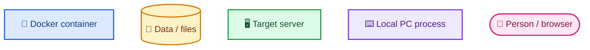
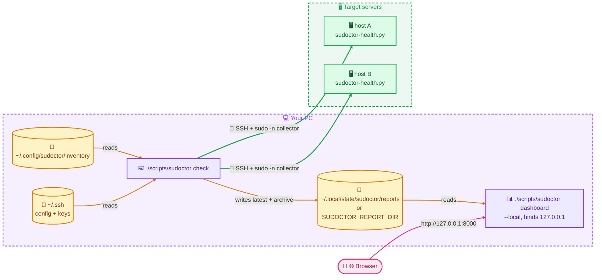
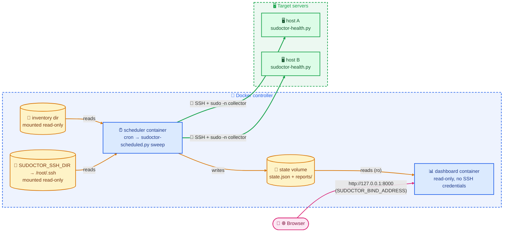
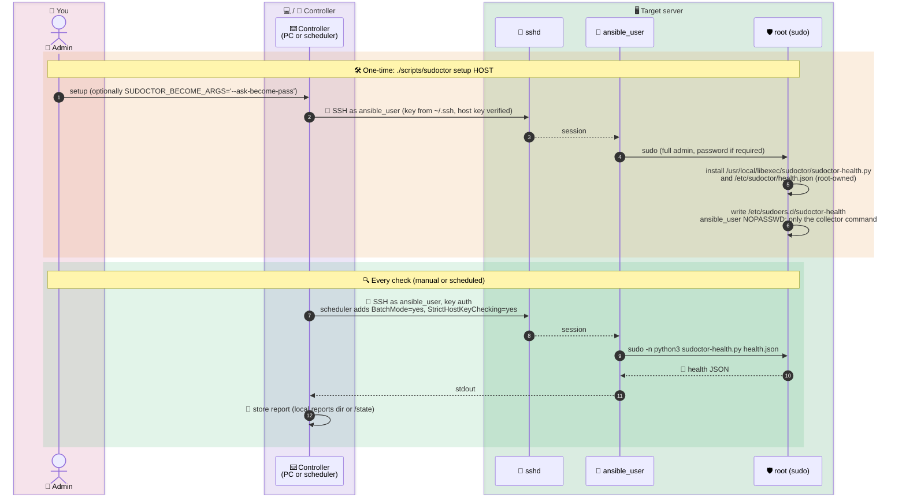
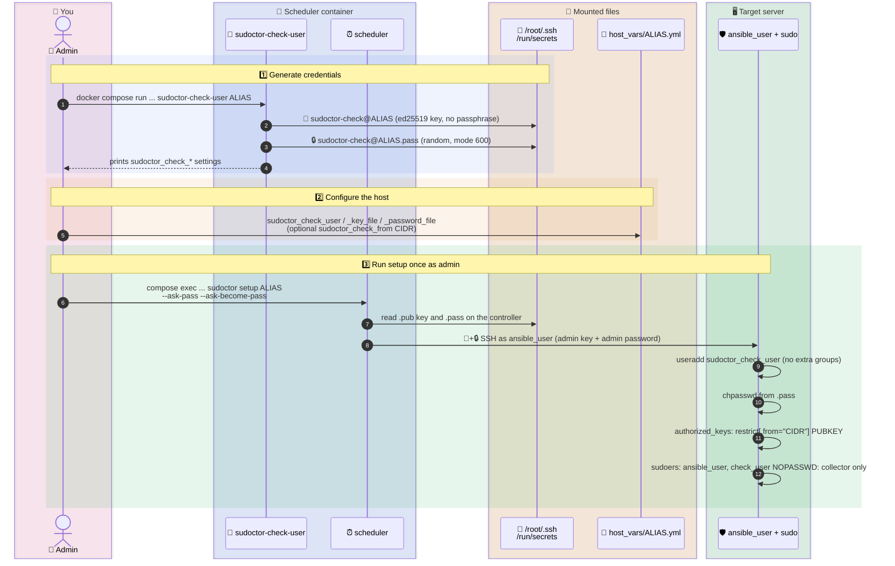
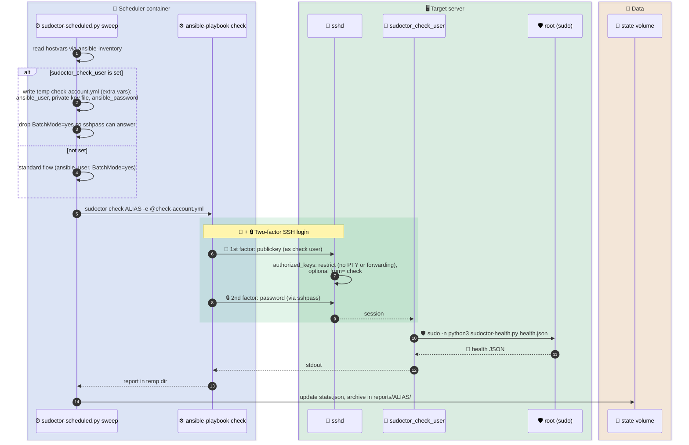

# How auth and connections work

These diagrams show who connects to whom, which account each connection uses, and where reports end up. They cover three flows:

1. [How reports reach a dashboard](#1-how-reports-reach-a-dashboard). Two independent setups: [local PC](#1a-local-pc-manual) or [Docker controller](#1b-docker-controller-scheduled).
2. [Standard check](#2-standard-check-ssh-key--restricted-sudo). SSH key plus restricted sudo, using the inventory's `ansible_user`.
3. [Dedicated check account](#3-dedicated-check-account-ssh-key--password). SSH key plus password, for hosts whose `sshd` requires both.

## Legend

Every diagram uses the same color code:

Arrows in the flowcharts: **green** = SSH to a server, **amber** = reading or writing report files, **pink** = HTTP from a browser.

## 1. How reports reach a dashboard

There are two independent ways to run sudoctor. Pick the one that fits. You don't need both, and neither depends on the other. If you do run both, each keeps its own reports and its own dashboard.

In both cases the servers never connect back. The controller (your PC or the scheduler container) opens the SSH connection and pulls the JSON report.

### 1a. Local PC (manual)

You run checks yourself from your PC. No Docker is needed.

The dashboard only reads files, so it works without an inventory or SSH access. Run a check, then press **Refresh**.

### 1b. Docker controller (scheduled)

An always-on machine runs checks on a cron schedule. Your PC is only needed to open the dashboard.

Only the scheduler container holds SSH credentials. The dashboard container gets the state volume read-only.

Neither dashboard has built-in authentication. Both bind to loopback by default.

## 2. Standard check: SSH key + restricted sudo

This is the default for every host. One account (`ansible_user` from `hosts.ini`) does everything. `setup` uses its full sudo rights once. After that, checks can run only the fixed collector command without a password.

What the restricted sudo rule allows:

- `check` runs `sudo -n` with only the exact collector path and config path. Any other command still needs a sudo password, and `-n` fails instead of prompting.
- `update`, `reboot` and `recover` use normal sudo authentication.

## 3. Dedicated check account: SSH key + password

Use this for hosts where `sshd` has `AuthenticationMethods publickey,password`. The scheduler can't type a password, so it logs in as a separate low-privilege `sudoctor_check_user`, and `sshpass` supplies the stored password. Admin actions keep using `ansible_user`.

### Provisioning (once per host)

### Scheduled check

Why extra vars: Ansible extra vars take priority over inventory values. The scheduler can override the login account for each run without changing the inventory, so `setup`, `update`, `reboot`, `recover` and manual `check` keep using `ansible_user`.

## Accounts at a glance

| Action | Runs from | SSH account | Auth to sshd | Privilege on target |
| --- | --- | --- | --- | --- |
| `setup`, `update`, `reboot`, `recover` | PC or scheduler (`exec`) | `ansible_user` | your SSH key (+ password if sshd requires it) | full sudo, normal authentication |
| `check`, manual | PC | `ansible_user` | your SSH key | `sudo -n` for the collector only |
| `check`, scheduled, standard host | scheduler | `ansible_user` | key, `BatchMode=yes` | `sudo -n` for the collector only |
| `check`, scheduled, key + password host | scheduler | `sudoctor_check_user` | restricted key + password via `sshpass` | `sudo -n` for the collector only |
| dashboard (local or Docker) | PC or dashboard container | none | none | reads report files only |
