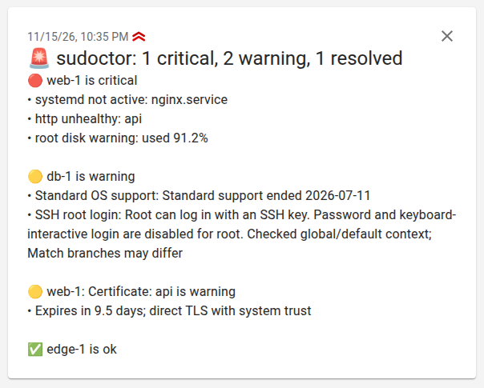
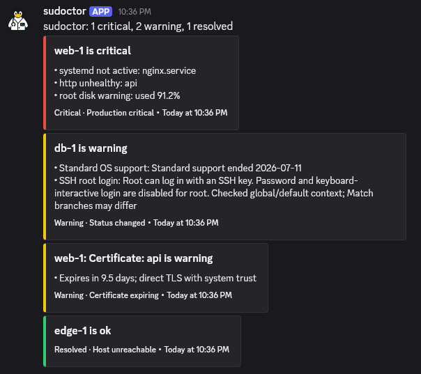
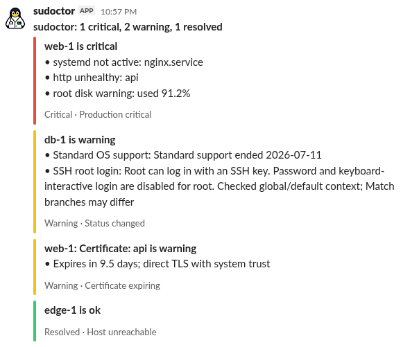

# Notifications

Scheduled checks can send notifications to ntfy, Discord, Slack, any JSON webhook, or a channel you add yourself. Notifications run in the scheduler only (the [Docker deployment](../docker/README.md)), after each sweep. Manual CLI runs already signal problems with their exit code.

The model has three layers:

- **Plugin**: knows *how* to send. Built-ins live in [scripts/notify-plugins/](../scripts/notify-plugins/); your own go in [plugins/](../plugins/).
- **Provider**: a named, configured plugin instance, such as `phone` (ntfy) and `ops` (Discord). One plugin can have many providers.
- **Rule**: conditions on a host or check, which providers to notify, and when.

Everything is configured in one `notify.json` file. Without that file, notifications are off. Start from [notify.example.json](../docker/notify.example.json) and validate it in your editor with [notify.schema.json](../schemas/notify.schema.json).

## Setup with Docker

1. Create `${XDG_CONFIG_HOME:-~/.config}/sudoctor/notify/notify.json`, or set `SUDOCTOR_NOTIFY_DIR` in `.env` to another directory. Compose mounts it read-only at `/app/notify`.
2. Put secrets (tokens, webhook URLs) in separate files in the same directory, readable only by you, and reference them with `*_file` options (see [Secrets](#secrets)).
3. Optionally set `SUDOCTOR_PUBLIC_URL` to your dashboard URL so messages include a link.
4. Check the configuration and send sample messages (see [Testing notifications](#testing-notifications)):

   ```bash
   docker compose exec scheduler /app/scripts/sudoctor-scheduled.py notify-check
   docker compose exec scheduler /app/scripts/sudoctor-scheduled.py notify-test phone
   ```

`notify.json` is read at the end of every sweep, so changes apply on the next sweep without a restart. A broken configuration doesn't stop checks: the scheduler logs the error and stores it as `notify.error` in `state.json`, and sends nothing until it's fixed. Outside Docker, the scheduler reads `SUDOCTOR_NOTIFY_CONFIG` (default `${XDG_CONFIG_HOME:-~/.config}/sudoctor/notify.json`) and `SUDOCTOR_PLUGINS_DIR` (default the checkout's `plugins/`).

## Providers

```json
"providers": {
  "phone": {"plugin": "ntfy", "options": {"url": "https://ntfy.sh/my-topic", "token_file": "/app/notify/ntfy.token"}},
  "ops":   {"plugin": "discord", "options": {"webhook_url_file": "/app/notify/discord.url"}},
  "log":   {"plugin": "debug"}
}
```

| Plugin | Options |
| --- | --- |
| `webhook` | `url` (required), `token` (Bearer), `headers` (object). POSTs the whole [message](#message-format) as JSON. |
| `ntfy` | `url` topic URL (required), `token`, `priority` (`min`…`urgent`; default follows severity), `tags` (extra tags, added after the severity emoji). Publishes as JSON to the server root, with one block per item and an "Open dashboard" button when `SUDOCTOR_PUBLIC_URL` is set. |
| `discord` | `webhook_url` (required), `username`. One embed per notification, colored by severity. |
| `slack` | `webhook_url` (required), `channel` (legacy webhooks only). One attachment per notification with a severity-colored bar, and an "Open dashboard" button when `SUDOCTOR_PUBLIC_URL` is set. |
| `debug` | none; prints the message to the scheduler log |

### Secrets

Any option ending in `_file` is read from that file (surrounding whitespace removed) and passed to the plugin without the suffix: `token_file` becomes `token`, `webhook_url_file` becomes `webhook_url`. Setting both forms is an error. Paths are paths inside the scheduler container. Files are read on every sweep, so you can rotate a secret without a restart.

## Rules

Rules are evaluated top to bottom, once per host (`"scope": "host"`, the default) or once per item in the host's `checks` list (`"scope": "check"`).

```json
{
  "name": "Host unreachable",
  "scope": "host",
  "match": "all",
  "conditions": [{"field": "outcome", "op": "in", "value": ["unreachable", "timeout"]}],
  "for": "30m",
  "repeat": "12h",
  "notify_recovery": true,
  "severity": "critical",
  "message": "$host has not answered for 30 minutes",
  "stop_on_match": false,
  "providers": ["phone"]
}
```

| Key | Default | Meaning |
| --- | --- | --- |
| `name` | required | Unique name, shown in messages. Renaming a rule resets its state. |
| `scope` | `host` | `host` or `check`. Only `check` rules can use `check_*` fields. |
| `match` | `all` | `all` (AND) or `any` (OR) across conditions. An empty list always matches. |
| `conditions` | required | List of `{field, op, value}`. |
| `providers` | required | Provider names to notify. |
| `for` | `0s` | Conditions must keep matching this long before the first notification. |
| `repeat` | never | Send again at this interval while conditions keep matching. |
| `notify_recovery` | `false` | Send a resolved message when matching stops, if a notification was sent. |
| `severity` | from status | `info`, `warning` or `critical`. By default the host or check status; failed checks are `critical`. |
| `message` | generated | Summary template. `$field` inserts any field below, `$rule` the rule name. |
| `stop_on_match` | `false` | While this rule matches, later rules for the same host or check keep tracking state but don't send. |

Durations are a number followed by `s`, `m`, `h` or `d`. The scheduler only evaluates rules once per sweep, so `for` and `repeat` are rounded up to your sweep interval.

### How a rule fires

Each rule keeps a separate state for every host (or host and check). That state is stored in the scheduler's `state.json`:

1. When the conditions first match, the rule starts tracking the problem. After `for` has passed, it notifies once.
2. While the conditions still match, it is quiet unless `repeat` is set.
3. When they stop matching, the state is cleared. With `notify_recovery`, a resolved message is sent.

So a rule like `status = critical` sends one message when a host turns critical, not one every sweep. For a message on *every* change, match `status_changed = true`: it's true for exactly one sweep.

If no provider accepts a notification, it is retried on the next sweep. Resolved messages are not retried.

When a check fails to produce a report (`timeout`, `unreachable`, `check_error`), report fields such as `status` have no current value. Rules that use them keep their previous state, so an unreachable host doesn't count as "recovered". Only fields from the scheduler attempt (`host`, `groups`, `outcome*`, `report_age_seconds`) are evaluated then.

### Fields

| Field | Type | Meaning |
| --- | --- | --- |
| `host` | string | Inventory alias |
| `groups` | list | Inventory groups containing the host, including parent groups |
| `outcome` | string | This sweep's result: `ok`, `warning`, `critical`, `timeout`, `unreachable`, `check_error` |
| `previous_outcome` | string | The previous sweep's result, or `null` |
| `outcome_changed` | bool | `outcome` differs from the previous sweep (false on the first sweep) |
| `status` | string | Report status: `ok`, `warning`, `critical` |
| `previous_status` | string | Status of the previous report, or `null` |
| `status_changed` | bool | `status` differs from the previous report (false on the first report) |
| `issues`, `warnings` | list | Report issue and warning messages |
| `root_disk_used_percent`, `root_disk_free_mb` | number | Root filesystem usage |
| `memory_available_mb` | number | `MemAvailable` |
| `load_1m` | number | One-minute load average |
| `uptime_hours` | number | Uptime |
| `pending_updates` | number | Upgradable packages |
| `reboot_required` | bool | `/var/run/reboot-required` exists |
| `report_age_seconds` | number | Age of the newest report, even after failed attempts |
| `check_id` | string | For example `security.ssh_service`, `os_updates.support`, `security.certificate.api` |
| `check_category`, `check_label`, `check_message` | string | From the check |
| `check_status`, `check_previous_status` | string | `ok`, `warning`, `critical`, `unknown`; previous is from the previous report |
| `check_status_changed` | bool | Check status differs from the previous report |
| `check_value` | any | The check's raw value |
| `check_days_left` | number | Days until `check_value`, when it is a date (certificates, OS support end); otherwise `null` |

### Operators

| Operator | Value | Notes |
| --- | --- | --- |
| `=`, `!=` | single value | `true` never equals `1` |
| `>`, `>=`, `<`, `<=` | number | False when the field has no number |
| `contains`, `not_contains` | string | Substring; on lists, any item |
| `matches` | string | Glob with `*` and `?`, case-sensitive; on lists, any item |
| `in`, `not_in` | list | On lists, true when any item is in the value |

## Message format

Each provider receives at most one message per sweep, combining every notification for it. When two rules notify the same provider about the same host or check, they are merged into one item.

```json
{
  "title": "sudoctor critical: web-1",
  "text": "[critical] web-1 is critical\n  - systemd not active: nginx.service\nhttps://sudoctor.example.com",
  "severity": "critical",
  "timestamp_utc": "2026-11-15T08:00:00+00:00",
  "dashboard_url": "https://sudoctor.example.com",
  "items": [
    {"kind": "firing", "rules": ["Production critical"], "severity": "critical", "host": "web-1", "check_id": null,
     "since": "2026-11-15T08:00:00+00:00", "summary": "web-1 is critical", "details": ["systemd not active: nginx.service"], "fields": {"...": "..."}}
  ]
}
```

`kind` is `firing`, `repeat` or `resolved`. `summary` is one line (or your `message` template); `details` lists the host's issues and warnings (up to 10) or the check's message, and is empty for resolved items. `severity` is the highest severity among items that aren't resolved, or `ok` when all are resolved. `fields` holds every field listed above for that host or check.

### Examples

The `mixed` sample (`notify-test PROVIDER --sample mixed`) as delivered by the built-in plugins: one critical host, one warning host, a check warning and a recovery.

| ntfy | Discord | Slack |
| --- | --- | --- |
|  |  |  |

ntfy shows one block per item, marked by severity, with the worst severity as the title icon. Discord and Slack show one card per item with a severity-colored bar and the matching rules in the footer.

## Writing a plugin

A plugin is one Python file. Its file name without `.py` is the plugin name: `plugins/telegram.py` is used as `"plugin": "telegram"`. Names must use lowercase letters, digits, `-` or `_`, and must not clash with a built-in. Files starting with `_` are ignored.

```python
"""Telegram bot. Options: token (required), chat_id (required)."""
from sudoctor_notify import post_json

REQUIRED_OPTIONS = ('token', 'chat_id')   # optional: checked when the configuration loads


def validate_options(options):            # optional: return a list of error messages
    return [] if str(options['chat_id']).lstrip('-').isdigit() else ['chat_id must be a number']


def send(message, options):               # required
    post_json(f'https://api.telegram.org/bot{options["token"]}/sendMessage',
              {'chat_id': options['chat_id'], 'text': f'{message["title"]}\n{message["text"]}'})
```

- `send(message, options)` receives the [message](#message-format) and the provider's options, with `*_file` options already read. Raising an exception or returning `False` counts as a failure; anything else counts as success.
- `sudoctor_notify.post(url, data, headers)` and `post_json(url, body, headers=None)` send a POST request with a 10-second timeout and raise on HTTP errors. Plugins can import only what the scheduler image includes; the built-ins use just the Python standard library.
- Never hardcode credentials; read them from `options`.
- Look at the [built-in plugins](../scripts/notify-plugins/) for examples, and try yours with `notify-test --plugin NAME --sample all --dry-run` (see [Testing notifications](#testing-notifications)).

Plugins are ordinary Python code that runs inside the scheduler, which holds your SSH keys. Only install plugins you have read and trust. Compose mounts the plugins directory read-only at `/app/plugins`; by default this is the checkout's `plugins/` directory (ignored by Git), or set `SUDOCTOR_PLUGINS_DIR` in `.env`. Plugins are loaded on every sweep, so new files are picked up without a restart.

## Testing notifications

`notify-test` sends messages to one provider without running a sweep, so you can check formatting quickly. Without Docker, run it from the checkout as `./scripts/sudoctor-scheduled.py notify-test`; it reads the same `SUDOCTOR_NOTIFY_CONFIG` and `SUDOCTOR_PLUGINS_DIR`. It never changes the scheduler's alert state.

```bash
./scripts/sudoctor-scheduled.py notify-test discord                       # the "mixed" sample
./scripts/sudoctor-scheduled.py notify-test discord --sample warning --sample resolved
./scripts/sudoctor-scheduled.py notify-test discord --sample all          # every sample, one message each
./scripts/sudoctor-scheduled.py notify-test --list-samples
```

Choose what to send. Several sources can be combined, and each message is sent separately, one second apart:

| Source | What it sends |
| --- | --- |
| `--sample NAME` | Built-in examples: `mixed`, `critical`, `warning`, `unreachable`, `check`, `info`, `reminder`, `resolved`, `long` (tests truncation), `overflow` (15 items), or `all`. |
| `--events FILE` | Your own items from a JSON file; see [notify-events.example.json](../docker/notify-events.example.json). |
| `--reports PATH…` | Saved data run through your rules: report files, a report directory (such as `~/.local/state/sudoctor/reports`), or a scheduler `state.json`. |

An events file holds one item, a list of items (one message), `{"items": [...]}`, or a list of `{"items": [...]}` objects (one message each). Item keys are those of the [message format](#message-format); all are optional: `kind` (default `firing`), `severity` (`warning`), `host` (`example`), `check_id`, `summary` (`<host> is <severity>`), `details`, `rules`, `since`, `fields`.

With `--reports`, every rule that sends to the chosen provider is evaluated as if nothing had been sent before, and `for` delays are ignored. Add `--all-rules` to use every rule regardless of its providers. Inventory groups aren't known here, so rules on `groups` don't match, and `*_changed` fields are false.

### Without sending, or without notify.json

- `--dry-run` prints each HTTP request (headers and pretty-printed JSON body) instead of sending it. URL paths and authorization headers are hidden, because webhook URLs contain secrets. This works for plugins that send with `sudoctor_notify.post`, `post_json` or `urllib.request.urlopen`.
- `--plugin NAME --option KEY=VALUE` tries a plugin directly, without a provider in `notify.json`. Values are parsed as JSON when possible (`--option 'tags=["a","b"]'`), and `KEY_file=PATH` reads a file as usual.

```bash
./scripts/sudoctor-scheduled.py notify-test --plugin telegram --option token_file=~/.config/sudoctor/telegram.token --option chat_id=123 --sample all
./scripts/sudoctor-scheduled.py notify-test --plugin discord --option webhook_url=https://discord.com/api/webhooks/x/y --sample long --dry-run
```

The exit code is 0 when every message was sent, 1 when a plugin failed, and 2 for invalid arguments or configuration.

## Limitations

- No scheduled digest or quiet hours yet.
- Rules run only after a complete sweep; a long sweep delays notifications.
- Resolved messages are sent once, without retry.
- The dashboard does not show notification state or errors yet; see the scheduler log or `state.json`.
